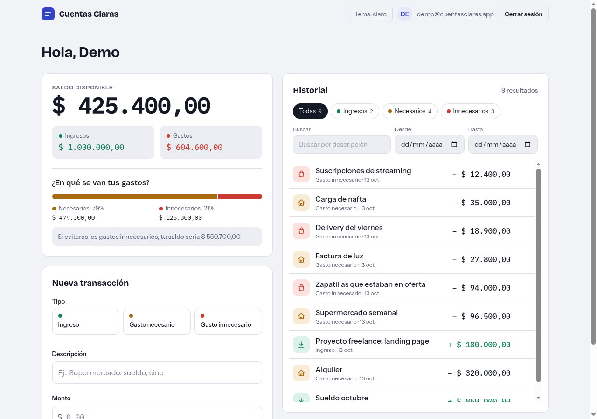
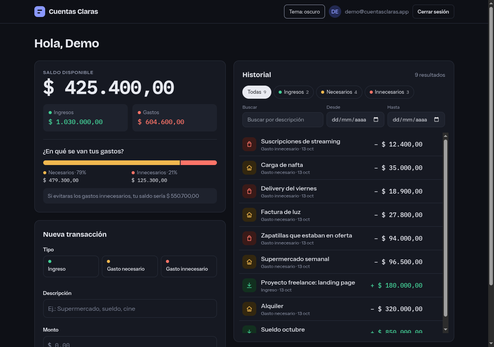
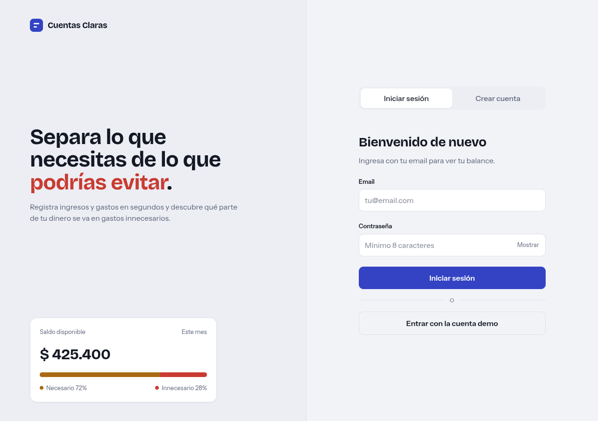
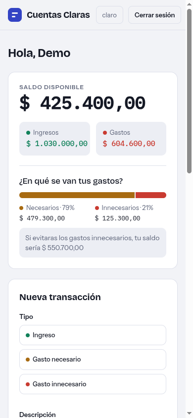

# Cuentas Claras

Gestor de gastos personales que te ayuda a ver a dónde se va tu dinero: separa el **gasto necesario** (alquiler, supermercado, luz) del **gasto innecesario** (delivery, suscripciones, compras impulsivas) y te muestra cuánto tendrías si evitaras los segundos.



| Modo oscuro | Login | Móvil (390 px) |
| --- | --- | --- |
|  |  |  |

## Funcionalidades

- Saldo, ingresos y gastos, con desglose necesario / innecesario y proyección "si evitaras los gastos innecesarios".
- Alta de transacciones con tres tipos (ingreso, gasto necesario, gasto innecesario) y validación de montos en formato `1.234,50`.
- Historial con filtros por tipo (chips), búsqueda por descripción con debounce y rango de fechas, todo resuelto en el backend.
- Eliminar con **deshacer** (borrado lógico y endpoint de restauración).
- Tema claro, oscuro o del sistema; diseño responsive.
- Login y registro, más una cuenta demo de un clic.

## Stack

- **Frontend:** Angular 16, Tailwind CSS, RxJS.
- **API:** NestJS + TypeORM + MySQL, en el repo hermano `nest-expense-manager`.

## Cómo correrlo

1. Backend (en `../nest-expense-manager`):

   ```bash
   docker compose up -d --build
   DATABASE_HOST=127.0.0.1 DATABASE_PORT=3307 npm run seed:demo   # datos de ejemplo
   ```

   La API queda en `http://localhost:3000/api/v1`.

2. Frontend (en este repo):

   ```bash
   npm install
   npm start
   ```

   Abre `http://localhost:4200`.

## Cuenta demo

Usa el botón **Entrar con la cuenta demo** o ingresa con:

- Email: `demo@cuentasclaras.app`
- Contraseña: `portfolio2026`

## Convención de montos

Los montos viajan y se guardan como **enteros en centavos** (`$ 10,50` se envía como `1050`). La conversión y el formato viven en `src/app/utils/money.ts`; los gastos son negativos y los ingresos positivos.

## Tests

```bash
# Frontend (CHROME_BIN es opcional: úsalo si Chrome no está en el PATH)
CHROME_BIN=/usr/bin/google-chrome npx ng test --watch=false --browsers=ChromeHeadless

# Backend (en ../nest-expense-manager)
npx jest
```

## Diseño

La maqueta de referencia del rediseño está en [`docs/design/cuentas-claras-demo.html`](docs/design/cuentas-claras-demo.html) (ábrela en el navegador).
